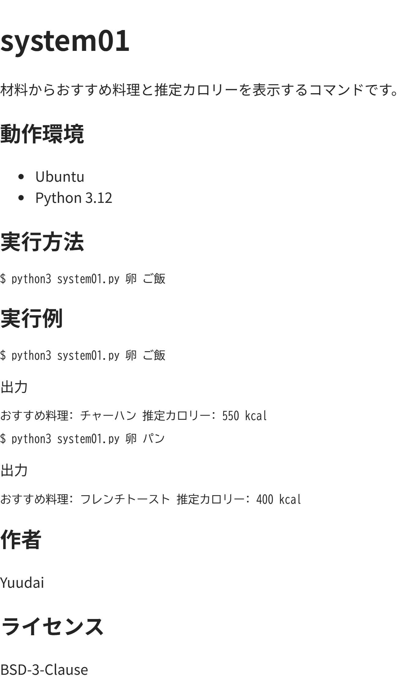

system01
材料からおすすめ料理と推定カロリーを表示するコマンドです。
## 必要なソフトウェア
- Python
  - テスト済みバージョン: 3.10〜3.14

## テスト環境
- Ubuntu 24.04 LTS
- 使用方法

標準入力から材料を入力して実行します。

$ echo "卵 パン" | python3 system01/system01.py
- 実行例
- 

卵とパンを入力した場合
おすすめ料理: チャーハン
推定カロリー: 550 kcal

卵とパンを入力した場合

おすすめ料理: フレンチトースト
推定カロリー: 400 kcal

該当する料理がない場合
卵とパンを入力した場合

おすすめ料理: フレンチトースト
推定カロリー: 400 kcal

該当する料理がない場合

おすすめ料理: 料理なし
推定カロリー: 0 kcal

- このソフトウェアパッケージは、3条項BSDライセンスの下、再頒布および使用が許可されます。
  - © 2026 Yudai  Tsutsumida

55b0190 (Update README)
